# Diagrama de Caso de Uso

Baseado na especificacao funcional e nas telas atualmente expostas pelo frontend, em formato PlantUML.

## Escopo considerado

- Login
- Inicio
- Estoque > Produtos
- Estoque > Categorias
- Decants
- Body Splash
- Vendas > Registrar Venda
- Vendas > Historico de Vendas
- Vendas > Pedidos Online
- Gestao de Pessoas
- Configuracoes
- Interacoes globais do layout

## Atores

- Funcionario
- Administrador
- Backend de Autenticacao

```plantuml
@startuml
left to right direction
skinparam packageStyle rectangle

actor "Funcionario" as Func
actor "Administrador" as Admin
actor "Backend de Autenticacao" as Auth

Admin -|> Func

rectangle "Sistema de Gestao da Perfumaria" {
  package "Acesso e Layout Global" {
    usecase "Autenticar-se no sistema" as UC_Login
    usecase "Exibir ou ocultar senha" as UC_TogglePassword
    usecase "Navegar entre telas" as UC_Navigate
    usecase "Visualizar notificacoes de estoque" as UC_Notifications
    usecase "Marcar notificacoes como lidas" as UC_ReadNotifications
    usecase "Dispensar notificacao" as UC_DismissNotification
    usecase "Recolher ou expandir menu lateral" as UC_CollapseSidebar
    usecase "Encerrar sessao" as UC_Logout
  }

  package "Tela Inicio" {
    usecase "Visualizar painel inicial" as UC_Home
    usecase "Filtrar indicadores por periodo" as UC_FilterPeriod
    usecase "Visualizar KPIs e graficos" as UC_ViewKpis
    usecase "Consultar estoque critico" as UC_CriticalStock
    usecase "Acessar atalhos de vendas e pedidos" as UC_HomeShortcuts
    usecase "Simular painel sem dados" as UC_EmptySimulation
  }

  package "Tela Estoque - Produtos" {
    usecase "Consultar produtos em estoque" as UC_ViewProducts
    usecase "Filtrar produtos por categoria" as UC_FilterProductsCategory
    usecase "Filtrar produtos por status" as UC_FilterProductsStatus
    usecase "Pesquisar produtos por nome ou marca" as UC_SearchProducts
    usecase "Ordenar listagem de produtos" as UC_SortProducts
    usecase "Paginar listagem de produtos" as UC_PaginateProducts
    usecase "Cadastrar produto" as UC_CreateProduct
    usecase "Editar produto" as UC_EditProduct
    usecase "Excluir produto" as UC_DeleteProduct
  }

  package "Tela Estoque - Categorias" {
    usecase "Consultar categorias" as UC_ViewCategories
    usecase "Visualizar indicadores por categoria" as UC_ViewCategoryCards
    usecase "Paginar listagem de categorias" as UC_PaginateCategories
    usecase "Cadastrar categoria" as UC_CreateCategory
    usecase "Editar categoria" as UC_EditCategory
    usecase "Excluir categoria" as UC_DeleteCategory
  }

  package "Tela Decants" {
    usecase "Consultar tabela de decants" as UC_ViewDecants
    usecase "Pesquisar decants" as UC_SearchDecants
    usecase "Exportar tabela de decants" as UC_ExportDecants
    usecase "Cadastrar decant" as UC_CreateDecant
    usecase "Editar decant" as UC_EditDecant
    usecase "Excluir decant" as UC_DeleteDecant
  }

  package "Tela Body Splash" {
    usecase "Consultar tabela de body splash" as UC_ViewBodySplash
    usecase "Pesquisar body splash" as UC_SearchBodySplash
    usecase "Exportar tabela de body splash" as UC_ExportBodySplash
    usecase "Cadastrar body splash" as UC_CreateBodySplash
    usecase "Editar body splash" as UC_EditBodySplash
    usecase "Excluir body splash" as UC_DeleteBodySplash
  }

  package "Tela Registrar Venda" {
    usecase "Registrar venda" as UC_RegisterSale
    usecase "Selecionar canal da venda" as UC_SelectSaleChannel
    usecase "Selecionar cliente" as UC_SelectClient
    usecase "Cadastrar cliente rapido" as UC_QuickClient
    usecase "Adicionar item ao carrinho" as UC_AddCartItem
    usecase "Alterar quantidade de item" as UC_UpdateCartItem
    usecase "Remover item do carrinho" as UC_RemoveCartItem
    usecase "Aplicar desconto" as UC_Discount
    usecase "Informar frete" as UC_Freight
    usecase "Selecionar forma de pagamento" as UC_PaymentMethod
    usecase "Finalizar venda" as UC_FinishSale
  }

  package "Tela Historico de Vendas" {
    usecase "Consultar historico de vendas" as UC_ViewSalesHistory
    usecase "Visualizar KPIs de vendas" as UC_ViewSalesHistoryKpis
    usecase "Buscar venda ou cliente" as UC_SearchSalesHistory
    usecase "Filtrar por pagamento" as UC_FilterSalesPayment
    usecase "Filtrar por canal" as UC_FilterSalesChannel
    usecase "Filtrar por status da venda" as UC_FilterSalesStatus
    usecase "Visualizar recibo da venda" as UC_ViewReceipt
    usecase "Editar venda" as UC_EditSale
  }

  package "Tela Pedidos Online" {
    usecase "Consultar pedidos online" as UC_ViewOrders
    usecase "Visualizar KPIs de pedidos" as UC_ViewOrderKpis
    usecase "Buscar pedido ou cliente" as UC_SearchOrders
    usecase "Filtrar pedidos por status" as UC_FilterOrdersStatus
    usecase "Filtrar pedidos por canal" as UC_FilterOrdersChannel
    usecase "Visualizar detalhes do pedido" as UC_ViewOrderDetails
    usecase "Finalizar pedido" as UC_FinishOrder
    usecase "Informar codigo de rastreio" as UC_TrackingCode
    usecase "Desfazer finalizacao do pedido" as UC_RevertOrder
    usecase "Cancelar pedido" as UC_CancelOrder
  }

  package "Tela Gestao de Pessoas" {
    usecase "Consultar gestao de pessoas" as UC_ViewPeople
    usecase "Alternar entre clientes, fornecedores e funcionarios" as UC_SwitchPeopleTabs
    usecase "Pesquisar registros" as UC_SearchPeople
    usecase "Filtrar clientes por status" as UC_FilterClientsStatus
    usecase "Cadastrar cliente" as UC_CreateClient
    usecase "Editar cliente" as UC_EditClient
    usecase "Inativar cliente" as UC_DeactivateClient
    usecase "Reativar cliente" as UC_ReactivateClient
    usecase "Cadastrar fornecedor" as UC_CreateSupplier
    usecase "Editar fornecedor" as UC_EditSupplier
    usecase "Excluir fornecedor" as UC_DeleteSupplier
    usecase "Cadastrar funcionario" as UC_CreateEmployee
    usecase "Editar funcionario" as UC_EditEmployee
    usecase "Excluir funcionario" as UC_DeleteEmployee
  }

  package "Tela Configuracoes" {
    usecase "Consultar configuracoes" as UC_ViewSettings
    usecase "Alternar secao de configuracoes" as UC_SwitchSettingsSection
    usecase "Alterar limite critico de estoque" as UC_UpdateStockThreshold
    usecase "Salvar configuracoes de estoque" as UC_SaveStockSettings
    usecase "Alterar senha" as UC_ChangePassword
    usecase "Alterar e-mail de acesso" as UC_ChangeEmail
  }
}

Func --> UC_Login
Func --> UC_TogglePassword
Func --> UC_Navigate
Func --> UC_Notifications
Func --> UC_ReadNotifications
Func --> UC_DismissNotification
Func --> UC_CollapseSidebar
Func --> UC_Logout

Auth --> UC_Login

Func --> UC_Home
Func --> UC_FilterPeriod
Func --> UC_ViewKpis
Func --> UC_HomeShortcuts
Func --> UC_EmptySimulation

Admin --> UC_CriticalStock

Admin --> UC_ViewProducts
Admin --> UC_FilterProductsCategory
Admin --> UC_FilterProductsStatus
Admin --> UC_SearchProducts
Admin --> UC_SortProducts
Admin --> UC_PaginateProducts
Admin --> UC_CreateProduct
Admin --> UC_EditProduct
Admin --> UC_DeleteProduct

Admin --> UC_ViewCategories
Admin --> UC_ViewCategoryCards
Admin --> UC_PaginateCategories
Admin --> UC_CreateCategory
Admin --> UC_EditCategory
Admin --> UC_DeleteCategory

Func --> UC_ViewDecants
Func --> UC_SearchDecants
Func --> UC_ExportDecants
Func --> UC_CreateDecant
Func --> UC_EditDecant
Func --> UC_DeleteDecant

Func --> UC_ViewBodySplash
Func --> UC_SearchBodySplash
Func --> UC_ExportBodySplash
Func --> UC_CreateBodySplash
Func --> UC_EditBodySplash
Func --> UC_DeleteBodySplash

Func --> UC_RegisterSale
Func --> UC_SelectSaleChannel
Func --> UC_SelectClient
Func --> UC_QuickClient
Func --> UC_AddCartItem
Func --> UC_UpdateCartItem
Func --> UC_RemoveCartItem
Func --> UC_Discount
Func --> UC_PaymentMethod
Func --> UC_FinishSale
Func --> UC_Freight

Func --> UC_ViewSalesHistory
Func --> UC_ViewSalesHistoryKpis
Func --> UC_SearchSalesHistory
Func --> UC_FilterSalesPayment
Func --> UC_FilterSalesChannel
Func --> UC_FilterSalesStatus
Func --> UC_ViewReceipt

Admin --> UC_EditSale

Func --> UC_ViewOrders
Func --> UC_ViewOrderKpis
Func --> UC_SearchOrders
Func --> UC_FilterOrdersStatus
Func --> UC_FilterOrdersChannel
Func --> UC_ViewOrderDetails
Func --> UC_FinishOrder
Func --> UC_RevertOrder
Func --> UC_CancelOrder
Func --> UC_TrackingCode

Admin --> UC_ViewPeople
Admin --> UC_SwitchPeopleTabs
Admin --> UC_SearchPeople
Admin --> UC_FilterClientsStatus
Admin --> UC_CreateClient
Admin --> UC_EditClient
Admin --> UC_DeactivateClient
Admin --> UC_ReactivateClient
Admin --> UC_CreateSupplier
Admin --> UC_EditSupplier
Admin --> UC_DeleteSupplier
Admin --> UC_CreateEmployee
Admin --> UC_EditEmployee
Admin --> UC_DeleteEmployee

Admin --> UC_ViewSettings
Admin --> UC_SwitchSettingsSection
Admin --> UC_UpdateStockThreshold
Admin --> UC_SaveStockSettings
Admin --> UC_ChangePassword
Admin --> UC_ChangeEmail

UC_RegisterSale .> UC_SelectSaleChannel : <<include>>
UC_RegisterSale .> UC_SelectClient : <<include>>
UC_RegisterSale .> UC_AddCartItem : <<include>>
UC_RegisterSale .> UC_Discount : <<include>>
UC_RegisterSale .> UC_PaymentMethod : <<include>>
UC_RegisterSale .> UC_FinishSale : <<include>>
UC_QuickClient .> UC_SelectClient : <<extend>>
UC_Freight .> UC_RegisterSale : <<extend>>

UC_ViewSalesHistory .> UC_ViewSalesHistoryKpis : <<include>>
UC_ViewSalesHistory .> UC_SearchSalesHistory : <<include>>
UC_ViewSalesHistory .> UC_FilterSalesPayment : <<include>>
UC_ViewSalesHistory .> UC_FilterSalesChannel : <<include>>
UC_ViewSalesHistory .> UC_FilterSalesStatus : <<include>>

UC_ViewOrders .> UC_ViewOrderKpis : <<include>>
UC_ViewOrders .> UC_SearchOrders : <<include>>
UC_ViewOrders .> UC_FilterOrdersStatus : <<include>>
UC_ViewOrders .> UC_FilterOrdersChannel : <<include>>
UC_TrackingCode .> UC_FinishOrder : <<extend>>

UC_UpdateStockThreshold .> UC_SaveStockSettings : <<include>>
UC_ReadNotifications .> UC_Notifications : <<extend>>
UC_DismissNotification .> UC_Notifications : <<extend>>
@enduml
```

## Observacoes de alinhamento EF x front

- O frontend atual diferencia `Administrador` e `Funcionario` pelo menu e por algumas acoes do layout e das telas.
- `Estoque`, `Gestao de Pessoas` e `Configuracoes` aparecem como fluxos administrativos no menu.
- `Historico de Vendas` permite consulta para ambos, mas a edicao da venda aparece apenas para administrador.
- `Pedidos Online`, `Decants`, `Body Splash` e `Registrar Venda` estao disponiveis no layout para os dois perfis no estado atual do frontend.
- O caso `Simular painel sem dados` existe no codigo da tela Inicio, embora nao esteja descrito explicitamente na EF.
*** End Patch